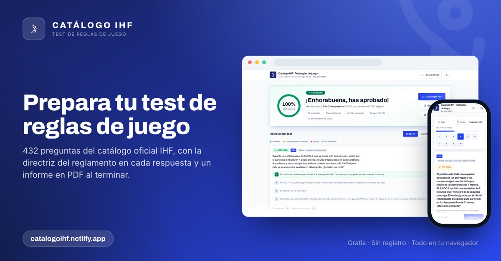

# Catálogo IHF · Test de reglas de juego

<p align="center">
  
</p>

Aplicación web de estudio para preparar los catálogos oficiales de preguntas de
las Reglas de Juego de la IHF. Eliges los temas y la duración del test,
respondes, consultas en cada pregunta la directriz del reglamento en la que se
basa esa respuesta, ves si apruebas (75 % o más) y descargas un informe en PDF.

**En marcha: <https://catalogoihf.netlify.app/>**

No hay nada que instalar: es un sitio estático que funciona entero en el
navegador y cada intento se queda en tu dispositivo.

## Qué es

Una herramienta de práctica para árbitros, formadores y opositores: convierte
los catálogos de preguntas de la IHF en tests interactivos con corrección
inmediata, acceso al reglamento y seguimiento del progreso. No hay cuentas, ni
servidores, ni envío de datos: el catálogo, el motor de corrección y las
estadísticas viajan con la web y viven en el navegador.

## Qué ofrece

- **432 preguntas** repartidas en **19 bloques temáticos**, desde el terreno de
  juego hasta las sanciones disciplinarias, pasando por el portero, el golpe
  franco, los 7 metros o la zona de cambios.
- **Tests a medida**: eliges los temas y la duración (5, 10, 20 o 30 preguntas)
  y cada intento se genera barajando el banco.
- **Corrección por respuesta**: cada opción correcta suma, una sola opción
  errónea anula la pregunta y la selección parcial de aciertos cuenta.
- **Pistas con el reglamento**: en cada pregunta puedes abrir las directrices
  que cita el catálogo, enlazadas a la página del PDF de las Reglas de Juego
  cuando la referencia corresponde a un capítulo conocido.
- **Nota y aprobado**: puntuación sobre el total de respuestas posibles, con el
  corte en el 75 % y dos decimales.
- **Repaso de fallos**: al terminar puedes repetir solo las preguntas falladas.
- **Estadísticas locales**: histórico por navegador con la mezcla de respuestas,
  la regla más y menos acertada y la evolución reciente.
- **Informe en PDF**: descarga un resumen con cabecera, totales y el detalle de
  aciertos y fallos, con estilos propios.
- **Todo en el dispositivo**: sin registro, sin cookies de terceros y con
  exportación del histórico en JSON antes de borrarlo.

## Cómo se usa

1. Elige los temas y la duración del test (5, 10, 20 o 30 preguntas).
2. Responde cada pregunta; el botón de pista muestra las directrices que el
   catálogo cita para esa respuesta.
3. Al terminar verás la puntuación, si apruebas (>= 75 % de las respuestas
   posibles) y la revisión pregunta a pregunta.
4. Descarga el informe en PDF, repite los fallos o empieza un test nuevo.
5. Abre **Estadísticas** en la cabecera para consultar el histórico guardado en
   este dispositivo.

## Cómo se puntúa

- La nota se calcula sobre el **número de respuestas posibles** del test, no
  sobre el número de preguntas: un test de 5 preguntas cuyas preguntas suman 9
  respuestas correctas se puntúa sobre 9 (`5/6 → 83,33 %`).
- Cada pregunta suma un punto por cada opción correcta marcada y cero si se
  marca alguna opción errónea; la selección parcial de aciertos sigue contando.
- Aprobado: `puntuación / respuestas posibles >= 0,75` (5/6, 7/9, 15/20),
  mostrado con dos decimales.

## Estadísticas en el dispositivo

Cada intento terminado se guarda en `localStorage` bajo `ihf.stats.v1`, por
navegador y por dispositivo: nada sale del navegador. De cada intento se
conservan la fecha, el porcentaje, la puntuación, el aprobado, la duración, el
tiempo empleado y una entrada por pregunta con su clasificación (acertada /
parcial / fallada / sin responder) y los puntos obtenidos.

- El botón **Estadísticas** aparece en la cabecera solo cuando este navegador
  tiene al menos un intento: es global para las tres pantallas y queda fuera de
  la zona de decisión de «Comenzar test». El diálogo compara la mitad reciente
  del histórico con la anterior, muestra la mezcla de respuestas, la regla más
  practicada (regla principal de `question.rules`) y la más floja en cuanto hay
  al menos 3 preguntas.
- Los intentos de «Repetir los fallos» se marcan como `retry`: cuentan para la
  práctica y para la precisión por regla, pero quedan fuera de la tendencia para
  que repetir fallos no haga parecer que empeoras.
- El histórico guarda los 200 intentos más recientes. Exporta el JSON antes de
  borrar; el diálogo también ofrece un borrado en dos pasos.
- Un almacenamiento corrupto, de otra versión o bloqueado (modo privado, cuota)
  degrada a un histórico vacío en lugar de romper la aplicación.

## Stack

Todo viaja con el sitio; en tiempo de ejecución no se carga nada desde una CDN.

- **Tailwind CSS 3.4.16** (en compilación) — utilidades compiladas y purgadas
  por Vite + PostCSS desde `styles/main.css`; el tema vive en
  `tailwind.config.js`. Tailwind v4 no se adopta a propósito: cambia la
  semántica por defecto de bordes y anillos y sería una migración visual aparte.
- **Fuentes variables Inter y Archivo** — subconjuntos `.woff2` autoalojados y
  servidos como recursos cacheables. Archivo se importa desde su subconjunto
  `wght`: el diseño no usa el eje de anchura y `standard` (wdth+wght) pesa 90 KB
  en latín frente a los 35 KB de `wght`.
- **jsPDF** — se carga con un `import()` dinámico en la primera descarga de PDF,
  así que sus ~342 kB quedan fuera de la carga inicial.

## Estructura

```
index.html          shell de la aplicación, hero estático (imagen LCP) y contenedores de pantalla
tailwind.config.js  tema (colores, tipografías, movimiento)
vite.config.js      configuración de build (copia documents/ a dist/, precarga de fuentes, metadatos del catálogo)
styles/             entrada de build y capa de CSS propio (se carga después de las utilidades)
scripts/
  app.js            entrada del bundler: metadatos del catálogo + main.js
  scoring.js        regla del 75 % sobre las respuestas posibles y estado de cada pregunta
  quiz.js           generador de intentos (barajado, respuestas, informe)
  stats.js          histórico por navegador y agregaciones (sin DOM)
  data.js           acceso a metadatos y load() de las preguntas, más el análisis de pistas
  hint.js           componente compartido de pista desplegable
  dialog.js         shell de modales: trampa de foco, Escape, bloqueo de scroll
  pdf-modal.js      visor de PDF dentro de la app para enlaces al reglamento
  render.js         utilidades de DOM, cambio de pantalla, iconos y avisos
  screens/          pantallas de configuración / test / resultados / estadísticas (un chunk cada una)
  pdf.js            informe jsPDF (cabecera, resumen, secciones de aciertos y fallos)
  main.js           ciclo de vida: importa las pantallas bajo demanda y pide jsPDF al vuelo
data/questions.js   conjunto de datos generado (no editar a mano); se pide en el primer «Comenzar test»
data/rules.js       texto de las reglas extraído: lo leen los tests, hoy no se publica
tools/extract_catalog.py   regenera el conjunto de datos a partir de los PDF
tests/              suite de node:test
```

## Desarrollo

```
pnpm install
pnpm dev      # servidor de desarrollo
pnpm build    # build de producción en dist/
pnpm test     # suite de node:test
pnpm lint
```

## Tests

La suite cubre la integridad del conjunto de datos, la regla del 75 % sobre las
respuestas posibles, la corrección por respuesta, la clasificación compartida de
preguntas, el motor de test, el almacén de estadísticas local y la resolución de
las citas de las pistas al texto de las reglas.

## Aviso

Los catálogos de preguntas y las Reglas de Juego son de la IHF. Esta aplicación
es una herramienta personal de estudio, sin vinculación con la federación.
